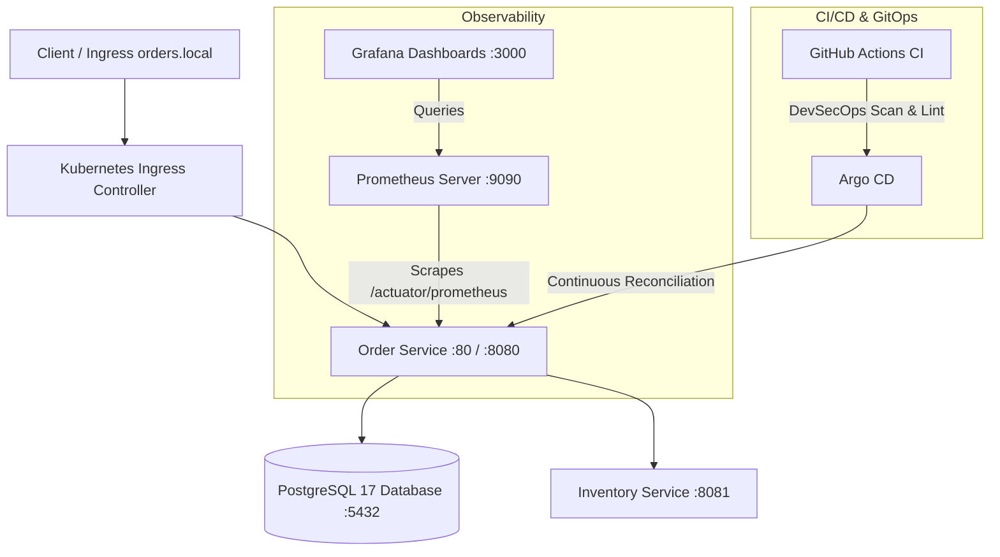

# OrderSystem: End-to-End Cloud-Native Microservices Platform

An enterprise-grade, cloud-native order processing platform built with **Spring Boot**, **PostgreSQL**, **Docker**, **Kubernetes (kind)**, **Helm**, **Prometheus & Grafana**, **DevSecOps Security Gates**, **Argo CD GitOps**, and **Terraform (AWS)**.

---

## Architecture Overview



---

## Project Structure

```
OrderSystemdeploy/
├── .github/workflows/
│   └── ci.yml                     # Full CI/CD Pipeline (Build, Test, Gitleaks, Trivy, Helm Lint)
├── application/
│   ├── order-service/             # Spring Boot 4 Order Service (JPA, Postgres, Actuator, Micrometer)
│   └── inventory-service/         # Spring Boot 4 Inventory Microservice (Availability & Reservation)
├── docker/
│   └── docker-compose.yml         # Local development environment with Healthcheck & Volume
├── kubernetes/
│   ├── kind-config.yaml           # Multi-node kind cluster (1 Control Plane + 1 Worker)
│   ├── 00-namespace.yaml          # Isolated "orders" namespace
│   ├── 01-secret.yaml             # Database credentials secret (base64 encoded)
│   ├── 02-configmap.yaml          # Spring Datasource URL configuration
│   ├── 03-postgres.yaml           # PostgreSQL PVC (1Gi) + Deployment + Service
│   ├── 04-order-service.yaml      # Order Service Deployment (2 replicas, probes, resources) + Service
│   ├── 05-hpa.yaml                # Horizontal Pod Autoscaler (2-5 replicas at 70% CPU)
│   ├── 06-ingress.yaml            # NGINX Ingress routing (orders.local)
│   ├── 07-inventory-service.yaml  # Inventory Service Deployment + Service
│   └── debug-drills/              # 6 Real-world Kubernetes failure manifests for exam practice
├── helm/
│   └── order-service/             # Reusable Helm chart with templates, helpers, and values.yaml
├── monitoring/
│   ├── 00-namespace.yaml          # Monitoring namespace
│   ├── 01-prometheus-config.yaml  # Scrape configs & alerting rules (OrderServiceDown)
│   ├── 02-prometheus.yaml         # Prometheus deployment & service (:9090)
│   ├── 03-grafana-datasource.yaml # Auto-provisioned Prometheus datasource
│   ├── 04-grafana-dashboard.yaml  # Auto-provisioned JVM & HTTP metrics dashboard
│   └── 05-grafana.yaml            # Grafana deployment & service (:3000)
├── security/
│   ├── .gitleaks.toml             # Secret scanner rules & allowlists
│   └── trivy.yaml                 # Vulnerability scanner configuration
├── gitops/
│   ├── application.yaml           # Argo CD Application Custom Resource
│   ├── app-of-apps.yaml           # Root GitOps App-of-Apps manifest
│   └── README.md                  # Argo CD setup guide
├── terraform/
│   ├── versions.tf & provider.tf  # AWS Provider configuration
│   ├── variables.tf & outputs.tf  # Input variables & connection outputs
│   ├── vpc.tf                     # High-availability VPC across 2 Availability Zones
│   ├── rds.tf                     # Managed AWS RDS PostgreSQL 17 instance
│   └── eks.tf                     # AWS EKS Kubernetes Cluster + Managed Worker Node Group
├── docs/
│   ├── runbook.md                 # Production Incident Triage Runbook
│   └── incident-postmortem.md     # Blameless Postmortem (INC-2026-1016)
├── LEARNING.md                    # Comprehensive study guide for Scaler DevOps exam
└── README.md
```

---

## Quickstart Guide

### 1. Prerequisites
* **macOS** with Docker Desktop running
* **kind** (`brew install kind`)
* **kubectl** (`brew install kubectl`)
* **Helm** (`brew install helm`)
* **Java 25** (`temurin`)

### 2. Launch Kubernetes Cluster
```bash
# 1. Create multi-node kind cluster
kind create cluster --config kubernetes/kind-config.yaml

# 2. Build and load Docker images into kind
docker build -t order-service:1.1 application/order-service
docker build -t inventory-service:1.0 application/inventory-service
kind load docker-image order-service:1.1 --name orders
kind load docker-image inventory-service:1.0 --name orders

# 3. Apply Kubernetes manifests
kubectl apply -f kubernetes/00-namespace.yaml
kubectl apply -f kubernetes/01-secret.yaml
kubectl apply -f kubernetes/02-configmap.yaml
kubectl apply -f kubernetes/03-postgres.yaml
kubectl apply -f kubernetes/04-order-service.yaml
kubectl apply -f kubernetes/07-inventory-service.yaml
```

### 3. Verify Deployment
```bash
kubectl get pods,svc,pvc -n orders
```

### 4. Test the Microservices
```bash
# Port-forward Order Service
kubectl port-forward -n orders svc/order-service 8080:80

# In another terminal:
# Create an order (validates inventory with inventory-service)
curl -i -X POST http://localhost:8080/api/orders \
  -H "Content-Type: application/json" \
  -d '{"productCode":"BOOK-123","quantity":2}'

# Fetch all orders from PostgreSQL
curl -i http://localhost:8080/api/orders
```

---

## Monitoring Stack (Prometheus & Grafana)

Deploy the monitoring stack:
```bash
kubectl apply -f monitoring/
```

Access the dashboards:
```bash
# Forward Grafana to localhost:3000
kubectl port-forward -n monitoring svc/grafana 3000:3000
```
* **URL**: http://localhost:3000
* **Credentials**: `admin` / `admin`
* The **Order Service Dashboard** is pre-loaded showing JVM Heap usage, HTTP request rate, and error counters!

---

## Helm Deployment

To deploy via Helm instead of raw YAML:
```bash
# Lint the chart
helm lint helm/order-service

# Deploy the release
helm install order-release helm/order-service -n orders

# Upgrade or Rollback
helm upgrade order-release helm/order-service -n orders
helm rollback order-release 1 -n orders
```

---

## Infrastructure as Code (Terraform AWS)

Inspect and validate the production AWS cloud infrastructure:
```bash
cd terraform
terraform init -backend=false
terraform validate
terraform plan # Generates execution plan for VPC, EKS, and RDS
```

---

## Kubernetes Debugging Playbook

The `kubernetes/debug-drills/` folder contains reproducible failure scenarios covering the 6 most heavily weighted exam scenarios:
1. `01-crashloop.yaml` — `CrashLoopBackOff`
2. `02-imagepull.yaml` — `ImagePullBackOff`
3. `03-pending.yaml` — `Pending` (CPU/Memory starvation)
4. `04-oomkilled.yaml` — `OOMKilled` (Exit Code 137)
5. `05-bad-probe.yaml` — Readiness Probe failure (`0/1 Running`)
6. `06-bad-secret.yaml` — `CreateContainerConfigError`

Refer to [docs/runbook.md](file:///Users/parthdagia/OrderSystemdeploy/docs/runbook.md) and [LEARNING.md](file:///Users/parthdagia/OrderSystemdeploy/LEARNING.md) for full diagnostic and recovery commands.
