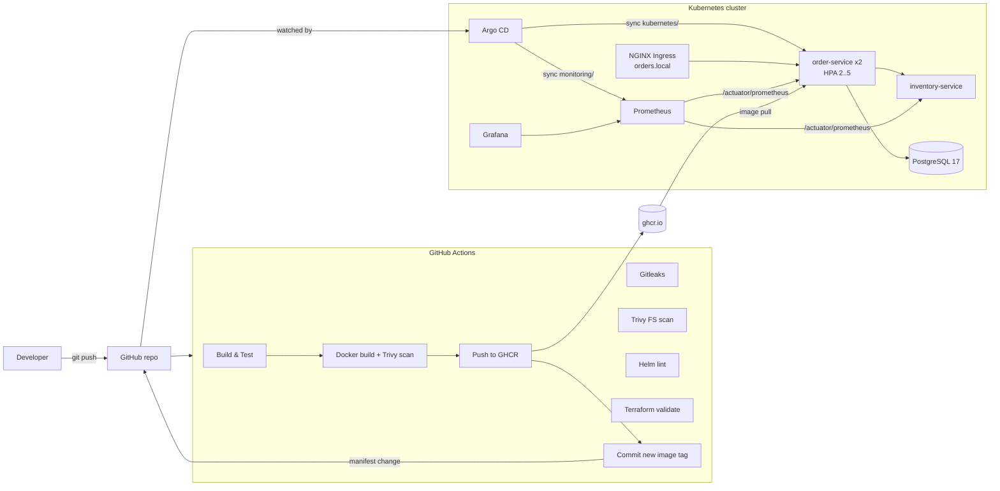
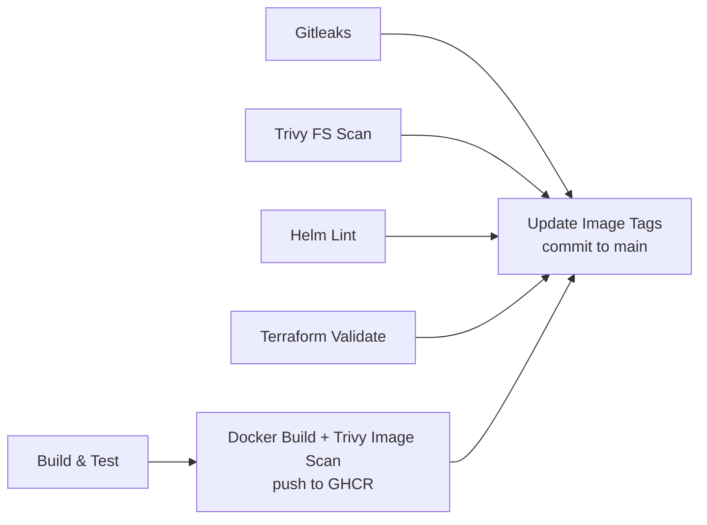

# OrderSystem: End-to-End Cloud-Native DevSecOps Platform

An order processing platform built from two Spring Boot microservices and shipped through a full DevSecOps pipeline: GitHub Actions CI with security gates, container images on GHCR, GitOps delivery with Argo CD, Kubernetes (kind locally, EKS on AWS), infrastructure as code with Terraform, and observability with Prometheus and Grafana.

📁 **Demo material**: [`demo/`](demo/) contains the slide deck and the presentation video.

---

## Table of Contents
1. [Architecture](#architecture)
2. [Tech Stack](#tech-stack)
3. [Project Structure](#project-structure)
4. [Setup](#setup)
5. [CI/CD Pipeline](#cicd-pipeline)
6. [GitOps with Argo CD](#gitops-with-argo-cd)
7. [Kubernetes](#kubernetes)
8. [Terraform (AWS)](#terraform-aws)
9. [Observability](#observability)
10. [Security](#security)
11. [Helm](#helm)
12. [Operations and Debugging](#operations-and-debugging)

---

## Architecture



**Request flow**: client → Ingress (`orders.local`) → `order-service` → checks stock on `inventory-service` → stores the order in PostgreSQL.

**Delivery flow**: push → CI builds, tests and scans → image pushed to GHCR tagged with the commit SHA → CI commits the new tag to `kubernetes/` → Argo CD detects the commit and rolls out the new pods.

**Cloud infrastructure** (Terraform): VPC across 2 AZs with public and private subnets, NAT gateway, EKS control plane plus a managed node group in the private subnets, and RDS PostgreSQL 17 reachable only from inside the VPC.

---

## Tech Stack

| Layer | Technology |
|---|---|
| Application | Java 25, Spring Boot 4.1, Spring Data JPA, Spring Boot Actuator, Micrometer |
| Database | PostgreSQL 17 (in-cluster), Amazon RDS (cloud) |
| Containers | Docker multi-stage builds, Docker Compose for local dev |
| Registry | GitHub Container Registry (`ghcr.io/parthdagia05`) |
| Orchestration | Kubernetes: kind (local), Amazon EKS (cloud) |
| Packaging | Helm 3 chart |
| CI | GitHub Actions |
| CD | Argo CD (GitOps, app of apps) |
| IaC | Terraform with the AWS provider |
| Security | Gitleaks (secrets), Trivy (dependencies, misconfig, container images), SHA-pinned actions |
| Observability | Prometheus (scraping and alert rules), Grafana (provisioned dashboard) |

---

## Project Structure

```
.
├── .github/workflows/ci.yml       # CI/CD pipeline (7 jobs)
├── application/
│   ├── order-service/             # REST API for orders, JPA + Postgres, calls inventory-service
│   └── inventory-service/         # REST API for stock levels
├── cluster/kind-config.yaml       # Local kind cluster (1 control plane + 1 worker, ports 80/443)
├── docker/docker-compose.yml      # Local dev: order-service + Postgres
├── kubernetes/                    # Plain manifests, synced by Argo CD
│   ├── 00-namespace.yaml … 07-inventory-service.yaml
│   └── debug-drills/              # Intentionally broken manifests for troubleshooting practice
├── helm/order-service/            # Helm chart for the same stack
├── monitoring/                    # Prometheus + Grafana manifests, synced by Argo CD
├── gitops/
│   ├── app-of-apps.yaml           # Root Argo CD Application
│   └── apps/                      # order-system and monitoring Applications
├── terraform/                     # AWS VPC, NAT, EKS, node group, RDS
├── security/                      # Gitleaks and Trivy configuration
├── scripts/bootstrap-kind.sh      # One command local cluster setup
├── docs/                          # Runbook and incident postmortem
├── demo/                          # Slides and presentation video
└── LEARNING.md                    # Concept notes
```

Key files:

| File | What it does |
|---|---|
| [`application/order-service/.../OrderService.java`](application/order-service/src/main/java/com/ordersystem/order/service/OrderService.java) | Business logic: inventory check, then save |
| [`application/order-service/Dockerfile`](application/order-service/Dockerfile) | Multi-stage build, JDK for build, JRE for runtime |
| [`.github/workflows/ci.yml`](.github/workflows/ci.yml) | Full pipeline |
| [`gitops/apps/order-system.yaml`](gitops/apps/order-system.yaml) | Argo CD Application for the app |
| [`terraform/eks.tf`](terraform/eks.tf) | EKS cluster, IAM roles, node group |
| [`monitoring/01-prometheus-config.yaml`](monitoring/01-prometheus-config.yaml) | Scrape jobs and alert rules |

---

## Setup

### Prerequisites
* Docker Desktop
* `kind`, `kubectl`, `helm` (`brew install kind kubectl helm`)
* Java 25 (Temurin) for building outside Docker
* `terraform` ≥ 1.5 and the AWS CLI (only for the AWS part)

### Option A: Docker Compose (quickest)
```bash
cd docker
docker compose up --build
curl http://localhost:8080/actuator/health
```

### Option B: Kubernetes with GitOps (full platform)
```bash
./scripts/bootstrap-kind.sh
```
The script:
1. creates the `orders` kind cluster from `cluster/kind-config.yaml`
2. installs ingress-nginx and metrics-server
3. installs Argo CD
4. applies `gitops/app-of-apps.yaml`, after which Argo CD deploys everything in `kubernetes/` and `monitoring/`

> The GHCR packages `order-service` and `inventory-service` must be **public** (GitHub → Packages → Package settings → Change visibility) so the cluster can pull them without credentials.

Check that everything is healthy:
```bash
kubectl get applications -n argocd
kubectl get pods,svc,ingress,hpa -n orders
kubectl get pods,svc -n monitoring
```

### Option C: Plain manifests without Argo CD
```bash
kind create cluster --config cluster/kind-config.yaml
kubectl apply -f kubernetes/
kubectl apply -f monitoring/
```

### Try the API
```bash
# via Ingress (add "127.0.0.1 orders.local" to /etc/hosts)
curl http://orders.local/api/orders

# or via port-forward
kubectl port-forward -n orders svc/order-service 8080:80

curl -X POST http://localhost:8080/api/orders \
  -H "Content-Type: application/json" \
  -d '{"productCode":"BOOK-123","quantity":2}'

curl http://localhost:8080/api/orders
curl http://localhost:8080/api/orders/1
```

| Endpoint | Service | Purpose |
|---|---|---|
| `POST /api/orders` | order-service | Create an order (checks stock first) |
| `GET /api/orders` | order-service | List orders |
| `GET /api/orders/{id}` | order-service | Get one order |
| `GET /api/inventory/{productCode}` | inventory-service | Stock for a product |
| `GET /actuator/health`, `/actuator/prometheus` | both | Health probes and metrics |

---

## CI/CD Pipeline

Defined in [`.github/workflows/ci.yml`](.github/workflows/ci.yml). Runs on every push and pull request to `main`, and can be started manually (`workflow_dispatch`).



| # | Job | What it does |
|---|---|---|
| 1 | **Build & Test** | Builds both services with Maven and runs tests. A `postgres:17` service container backs the order service test. |
| 2 | **Gitleaks** | Scans the full Git history for committed secrets. Fails the pipeline on a finding. |
| 3 | **Trivy FS scan** | Scans dependencies, IaC misconfiguration and secrets in the repo using [`security/trivy.yaml`](security/trivy.yaml). |
| 4 | **Docker Build & Image Scan** | Matrix over both services: builds the image, scans it with Trivy, and on `main` pushes `ghcr.io/parthdagia05/<service>:<sha>`. |
| 5 | **Helm Lint** | `helm lint` and `helm template` on the chart. |
| 6 | **Terraform Validate** | `terraform fmt -check`, `init -backend=false`, `validate`. |
| 7 | **Update Image Tags** | Only on `main`, after everything else passes: rewrites the image tags in `kubernetes/*.yaml` and `helm/order-service/values.yaml`, then commits `deploy: update image tags to <sha>`. That commit is what Argo CD deploys. |

Images are tagged with the commit SHA, so every running pod can be traced back to the commit that built it, and a rollback is a `git revert`.

---

## GitOps with Argo CD

Details in [`gitops/README.md`](gitops/README.md).

* **App of apps**: [`gitops/app-of-apps.yaml`](gitops/app-of-apps.yaml) points at `gitops/apps/`, which holds one Application per component:
  * `order-system` syncs `kubernetes/` into namespace `orders` (non-recursive, so `debug-drills/` is skipped)
  * `monitoring` syncs `monitoring/` into namespace `monitoring`
* **Automated sync** with `prune: true` and `selfHeal: true`: deleting a file from Git removes the resource, and manual changes in the cluster are reverted.
* **Access the UI**:
  ```bash
  kubectl port-forward svc/argocd-server -n argocd 8443:443
  kubectl -n argocd get secret argocd-initial-admin-secret -o jsonpath="{.data.password}" | base64 -d; echo
  ```
  Open https://localhost:8443 and log in as `admin`.

Self-heal demo: `kubectl scale deploy/order-service -n orders --replicas=1` and watch Argo CD bring it back to the replica count in Git.

---

## Kubernetes

Manifests in [`kubernetes/`](kubernetes/), applied in file order:

| File | Resources |
|---|---|
| `00-namespace.yaml` | `orders` namespace |
| `01-secret.yaml` | `db-credentials` Secret (DB username and password) |
| `02-configmap.yaml` | `SPRING_DATASOURCE_URL` pointing at the `postgres` Service |
| `03-postgres.yaml` | PVC (1Gi), Postgres Deployment and Service |
| `04-order-service.yaml` | Deployment (2 replicas, readiness and liveness probes, requests/limits) and ClusterIP Service |
| `05-hpa.yaml` | HorizontalPodAutoscaler, 2 to 5 replicas at 70% CPU |
| `06-ingress.yaml` | NGINX Ingress for host `orders.local` |
| `07-inventory-service.yaml` | Deployment and Service on port 8081 |

Design notes:
* **Probes**: readiness (`/actuator/health/readiness`) controls whether a pod gets traffic, liveness (`/actuator/health/liveness`) restarts a stuck container.
* **Resources**: requests drive scheduling and HPA percentages, limits cap memory (exceeding it gives `OOMKilled`).
* **Config split**: non-secret config in a ConfigMap, credentials in a Secret, both injected as env vars.
* **Service discovery**: services talk through cluster DNS (`inventory-service:8081`, `postgres:5432`).

---

## Terraform (AWS)

Code in [`terraform/`](terraform/). Region `ap-south-1` by default.

| File | Resources |
|---|---|
| `vpc.tf` | VPC `10.0.0.0/16`, 2 public and 2 private subnets across 2 AZs, Internet Gateway, NAT Gateway, route tables. Subnets carry the `kubernetes.io/role/elb` tags EKS needs for load balancers. |
| `eks.tf` | EKS cluster (IAM role with `AmazonEKSClusterPolicy`) and a managed node group of `t3.medium` nodes (1 to 5, desired 2) in the private subnets |
| `rds.tf` | RDS PostgreSQL 17 (`db.t4g.micro`) in private subnets, security group allowing 5432 only from the VPC |
| `variables.tf` / `outputs.tf` | Inputs, and outputs for VPC ID, cluster endpoint, RDS endpoint and the `update-kubeconfig` command |

```bash
cd terraform
export TF_VAR_db_password='choose-a-strong-password'   # never committed
terraform init
terraform plan -out=tfplan
terraform apply tfplan

# connect kubectl to EKS
$(terraform output -raw configure_kubectl)
kubectl get nodes

# tear down when done (EKS, NAT and RDS are billed hourly)
terraform destroy
```

Every resource is tagged `Project=OrderSystem`, `ManagedBy=Terraform` through the provider's `default_tags`. State files and `*.tfvars` are gitignored; see [`terraform.tfvars.example`](terraform/terraform.tfvars.example). For team use the state would move to an S3 backend with locking.

---

## Observability

Manifests in [`monitoring/`](monitoring/), deployed by the `monitoring` Argo CD app.

* **Metrics source**: both services expose `/actuator/prometheus` through Micrometer (JVM, HTTP, Hikari pool, process metrics).
* **Prometheus** (`:9090`) scrapes `order-service` and `inventory-service` every 5s.
* **Alert rules**: `OrderServiceDown`, `InventoryServiceDown` (target down for 30s), `HighOrderErrorRate` (5xx rate).
* **Grafana** (`:3000`) comes with the Prometheus datasource and the **Order Service Dashboard** provisioned: service up status, JVM heap, HTTP request rate by endpoint and status, 5xx count.

```bash
kubectl port-forward -n monitoring svc/prometheus 9090:9090   # Status → Targets shows both services UP
kubectl port-forward -n monitoring svc/grafana 3000:3000      # admin / admin
```

Generate some traffic so the dashboard has data:
```bash
for i in $(seq 1 50); do
  curl -s -X POST localhost:8080/api/orders -H 'Content-Type: application/json' \
    -d '{"productCode":"BOOK-123","quantity":1}' > /dev/null
done
```

---

## Security

* **Secret scanning**: Gitleaks on the full history with [`security/.gitleaks.toml`](security/.gitleaks.toml), blocking.
* **Dependency and IaC scanning**: Trivy filesystem scan (vulnerabilities, misconfiguration, secrets).
* **Image scanning**: Trivy on each built image, HIGH and CRITICAL with fixes available. Image and FS scans currently report without failing the build; switching `exit-code` to `1` turns them into hard gates.
* **Supply chain**: all third-party GitHub Actions are pinned to commit SHAs; the workflow token defaults to read-only and jobs request only the scopes they need (`packages: write`, `contents: write`).
* **Least exposure**: services are ClusterIP behind an Ingress; RDS is private; the Terraform DB password comes from the environment.
* **Runtime images**: multi-stage builds ship only the JRE and the app jar.

---

## Helm

The [`helm/order-service`](helm/order-service/) chart packages the same stack (order service, Postgres, HPA, Ingress) with values in `values.yaml`.

```bash
helm lint helm/order-service
helm install order-release helm/order-service -n orders --create-namespace
helm upgrade order-release helm/order-service -n orders --set replicaCount=3
helm rollback order-release 1 -n orders
```

---

## Operations and Debugging

* [`docs/runbook.md`](docs/runbook.md): triage steps for common production incidents.
* [`docs/incident-postmortem.md`](docs/incident-postmortem.md): blameless postmortem example.
* [`kubernetes/debug-drills/`](kubernetes/debug-drills/): reproducible failures to practise on:
  `CrashLoopBackOff`, `ImagePullBackOff`, `Pending`, `OOMKilled` (exit 137), failing readiness probe, `CreateContainerConfigError`.

```bash
kubectl apply -f kubernetes/debug-drills/01-crashloop.yaml
kubectl get pods -n orders
kubectl describe pod <name> -n orders
kubectl logs <name> -n orders --previous
```
